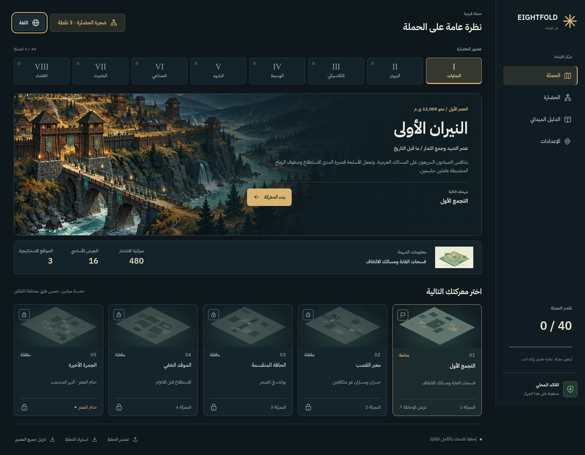

# EIGHTFOLD — The Art of Command

A single-player, silent, isometric real-time strategy game spanning eight ages of civilization and forty tactical fields. The opponent runs locally. No account, backend, paid service, remote font, or AI API is required.

## Run

Use Node.js 22.12 or newer (validated with Node 24.19) and npm.

```sh
cd /workspace/battle-game
npm ci
npm run dev
```

Vite prints the development port. Open the application using your development environment's supported browser access. The desktop layout is intended for a mouse, keyboard, and a viewport of at least 1100 × 720.

## العربية والإنجليزية

من **الإعدادات ← اللغة** اختر **العربية** أو **English**. يمكن تغيير اللغة من الحملة أو أثناء المعركة، ويُحفظ الاختيار تلقائيًا. تدعم العربية اتجاه اليمين إلى اليسار وترجمة العصور والمهام والوحدات والمهارات والإرشادات والنتائج. تغيير اللغة لا يعيد المعركة ولا يغيّر أوامر الجيش أو موارده.

English and Arabic are available from **Settings → Language**, including during a battle. The choice applies immediately and persists with the campaign. Arabic uses a local Arabic font and mirrored interface; world positions, map coordinates and keyboard commands retain their meanings. Existing version-one saves without a language preference open in English.



## Build and deploy

```sh
npm run build
npm run preview
```

Publish **all contents of `dist/`** together to an HTTPS static host. Relative asset paths support a subdirectory deployment. The build generates a content-versioned Service Worker, including the hashed simulation Worker bundle. No server-side routes or environment secrets are necessary.

The development server deliberately does not register an offline worker. Test PWA/offline behavior using the production build and preview server, or an HTTPS deployment. Choose **Download all eras** on the campaign screen before going fully offline. Progress reaches 100% only after all required core files and eight era illustrations are cached. Updates wait for existing tabs to close before activation, keeping an open session's assets consistent.

## Play

Capture the enemy main stronghold by occupying its ring. Contested occupation is gradual; defenders can reverse it. Outposts grant a finite first-capture supply reward and a capacity bonus while held. Supplies come exclusively from kills and first captures. Waiting never creates supplies.

Each age has five battles; the fifth is its finale. Win to unlock the next field, including the first field of the following age. Completed battles remain replayable. Score thresholds grant skill points once per mission threshold. A better replay can earn an unclaimed threshold; repeating the same result cannot duplicate rewards. Defeat retains campaign progress and can claim limited rewards at half performance.

Select your main stronghold to train soldiers. Units have distinct costs, capacity, training time, strengths, and weaknesses. Cancellation refunds 100% before training starts and 50% after it starts. Completed training uses a limited reserve when deployment is unavailable. Reserve priorities remain stable when the deployment system temporarily skips an oversized unit. Losing outpost capacity never kills or weakens deployed soldiers.

Buy civilization or era skills between missions. Older era skills remain recorded but their military effects apply only in their own age. Recruiting uses the current era's roster. New purchases apply to new battles; a resumed battle restores the exact original simulation snapshot.

| Input | Action |
|---|---|
| Left-click / drag | Select object / select army rectangle |
| Shift + selection | Add soldiers to selection |
| Right-click | Contextual move, attack, capture, or defend |
| Shift + right-click | Append a sequential order |
| Space | Tactical pause; continue selecting and planning |
| Arrow keys / middle drag | Pan camera |
| Mouse wheel | Zoom |
| Ctrl + 1–9 | Assign control group |
| 1–9 / Shift + 1–9 | Recall / add to a control group |
| F / S / H | Cycle formation / stop / focus home |
| Q / R / T / V | Unit ability / rally / reconnaissance / volley |
| Minimap left / right click | Camera navigation / selected army order |

The contextual command panel supports editing and reordering planned actions. Skill connections, requirements, costs, and purchased states are shown in a pannable, zoomable tree. During combat the tree can be inspected; purchases are blocked.

## Saving

IndexedDB stores the campaign and complete active battle together, with a previous valid snapshot retained for recovery. Autosave runs every five seconds. Returning to the campaign saves and pauses the battle; resume restores both armies, queues, reserves, orders, fog history, AI plans, structures, resources, and cooldowns. Hiding the browser tab automatically pauses the battle.

Export a portable JSON save from the campaign or battle menu. Import from the campaign screen. Imports are versioned and validated, including finite values, references, reward ledgers, progression, and economic consistency. Local save files are not cryptographically authenticated; this is an offline single-player game. See [save design](docs/SAVES.md).

## Validate

```sh
npm run check
npm test
npm run build
```

The automated suites use Node's test runner against the same TypeScript simulation and content used in the browser. Browser and performance instructions and actual measurements are recorded in [verification](docs/VERIFICATION.md).

## Architecture and assets

- `src/contracts.ts`: typed command protocol and serializable state.
- `src/content/`: reviewable era rosters, branching skills, forty individually authored mission configurations, runtime validation.
- `src/sim/engine.ts`: deterministic fixed-step combat, finite economy, capture, production, reserves, visibility, construction, abilities, scoring, and defeat.
- `src/sim/navigation.ts`, `ai.ts`: weighted A*, local collision avoidance, terrain/formation modifiers, and observation-only utility AI.
- `src/worker.ts`: simulation/AI at 10 fixed ticks per second, isolated from WebGL rendering.
- `src/render/`: Phaser WebGL, isometric terrain, original equipment/architecture, animation atlases, interpolation, fog, and effects.
- `src/ui/`: functional campaign, fixed contextual HUD, interactive minimap, production, queues, skills, tutorials, and results.
- `src/i18n/`: complete Arabic campaign content, interface messages and dynamic text templates; original IDs and save references remain language independent.
- `src/persistence/`: IndexedDB transactions, backup recovery, save validation, and idempotent progression.
- `scripts/build-sw.mjs`: self-contained, content-versioned offline cache generation.

The interface was redesigned using the installed [UI UX Pro Max skill](.agents/skills/ui-ux-pro-max/SKILL.md): a dark command center, unified SVG icons, mission-map previews and locally packaged English/Arabic typography. Decisions are recorded in the [design system](design-system/eightfold/MASTER.md).

Terrain, equipment, architecture, era illustrations, icons and animations are original programmatically authored artwork. The campaign cover is original AI-assisted key art. Local Manrope and IBM Plex Sans Arabic font files include their OFL licenses. See [asset provenance](docs/ASSETS.md). Phaser and the development dependencies retain their respective licenses.

See [the specification](docs/SPECIFICATION.md), [mission design](docs/CONTENT.md), [AI/navigation design](docs/NAVIGATION_AI.md), and [implementation ownership](docs/IMPLEMENTATION.md). Verified behavior and remaining limitations are documented separately from the requested specification.
