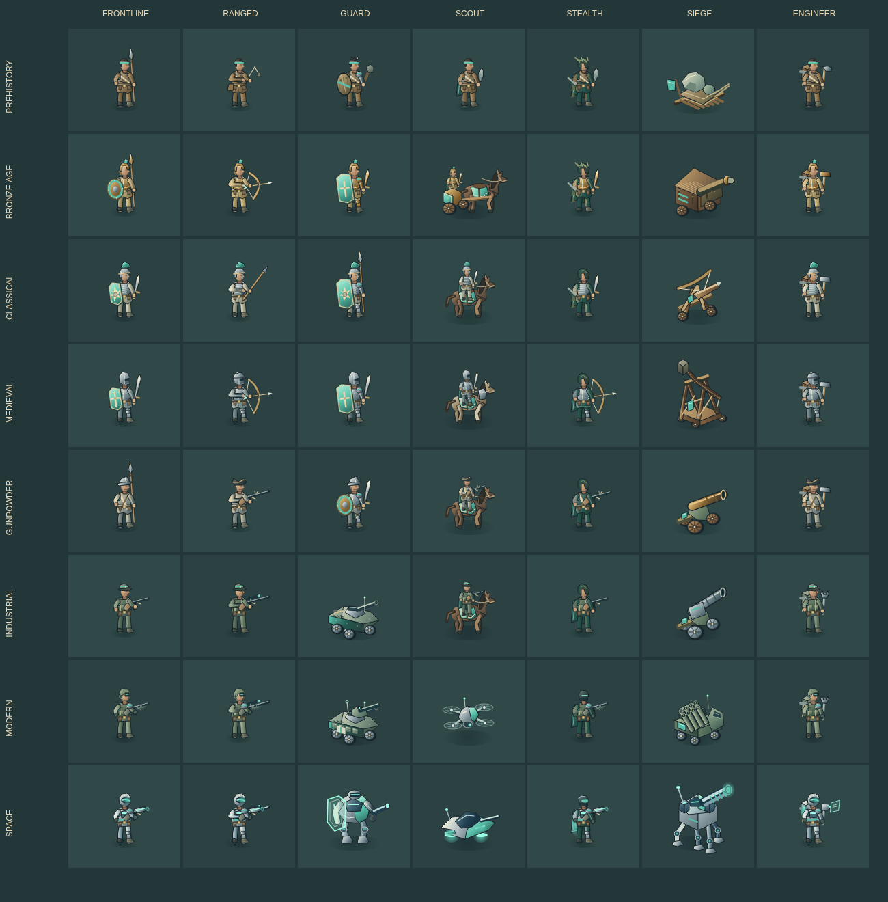
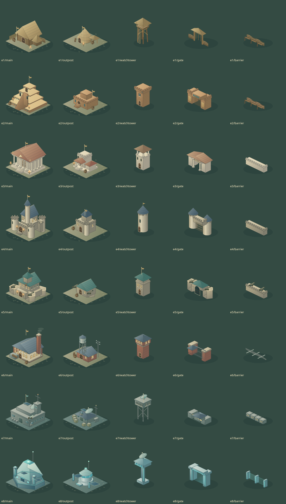
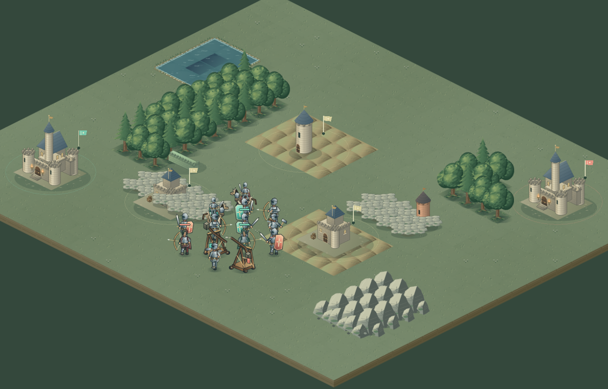
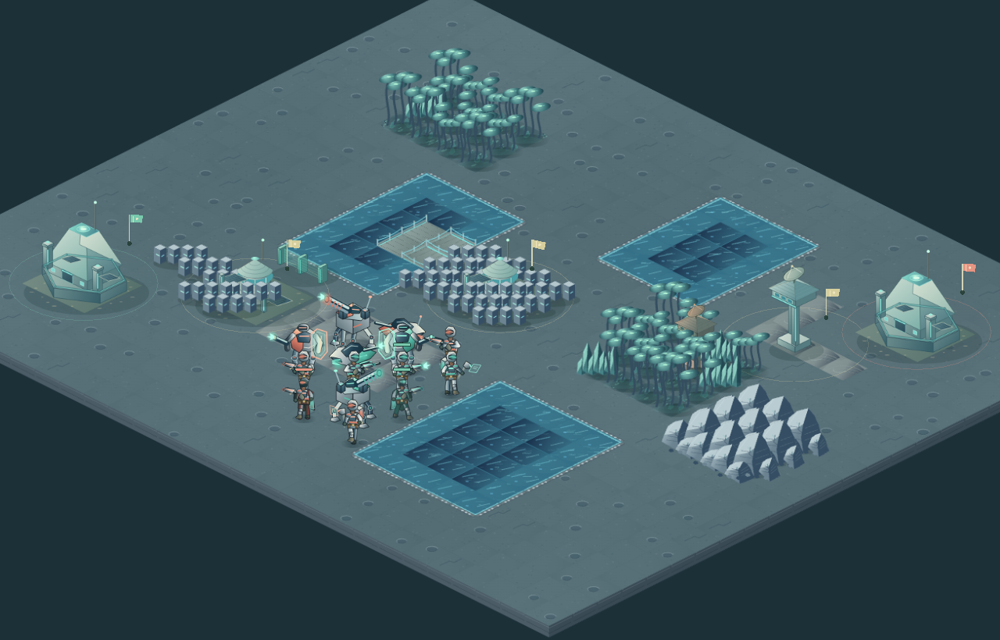
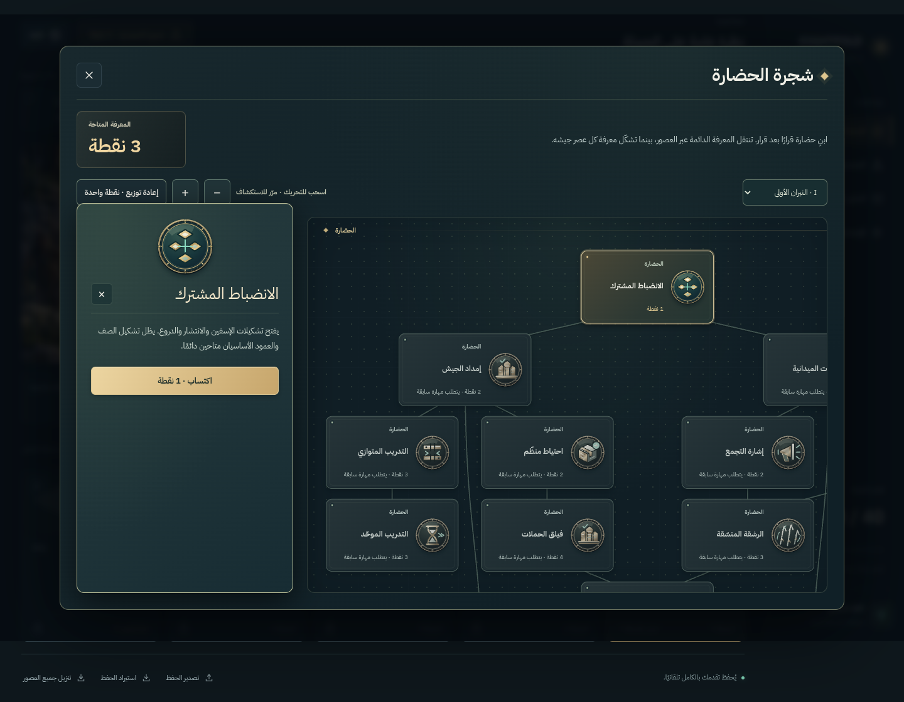

# Detailed artwork across eight eras

The graphics update replaces the original small geometric battlefield drawings with original illustrated soldiers, equipment, architecture and environments. It remains a 2D isometric strategy game, with a shared material palette and clear tactical silhouettes.

## Units and weapons

All 51 playable roster entries are covered by 56 era/role art designs. Both teams have their own trim, and four articulated poses produce 448 possible frames. The atlas includes hide-clad spearmen, sling hunters, bronze shields and chariots, classical infantry and torsion artillery, mailed medieval soldiers and trebuchets, pikes and matchlocks, rifle sections and howitzers, modern drones/armor/rockets, and futuristic marines/skimmers/mechs/walkers. Boots, straps, hair, helmet crests, shield decoration, horse tack, axles, wheels, tracks and weapon details are drawn in the source painters.

## Strongholds and terrain

Fortifications change their construction across the campaign: timber settlement, mudbrick palace, marble civic stronghold, masonry castle, bastioned gunpowder fort, brick industrial works, modern radar command base and lit colony nexus. Outposts have distinct silhouettes; watchtowers, gates and barriers use the same era's materials.

Forests, rocks, cliffs, cover, water, coastlines, bridges and small ground details use eight environment palettes. Tall scenery is kept separate from the static ground cache so troops pass behind or in front of trees and buildings correctly. The space environment includes craters, pale alloy, crystals and luminous vegetation.

The following are actual WebGL renderer screenshots from the disposable art-review harness, using a revealed, paused test state to show each era's whole roster and fortifications together:

## Research and interface details

Sixteen engraved medallions identify skill effects. Prerequisite lines, acquired/available/locked states, permanent and era branches, and an inspected skill's details remain connected to the actual skill data. Unit and building portraits in selection, recruitment and reserves come from the same painters as the battle sprites.

Era-specific projectile arcs, fletching, muzzle flashes, powder smoke, artillery dust, rocket exhaust, pulse traces, capture glints and construction effects use bounded rendering budgets. Events still pass the same visibility checks before presentation.

## Runtime and verification

Only the active era's battle atlases are allocated. Static material detail is painted at creation time; gameplay frames use WebGL sprites. **High detail** keeps native resolution; **Adaptive performance** reduces resolution when the device is slow. Neither setting changes the simulation or saved battle.

Run `npm run test:art` with the Vite development server running. The browser matrix checks clipping, nonempty images, distinct poses, repeated map determinism, real WebGL scene creation and cleanup. It also records native-resolution software-renderer timing without asserting a hardware FPS target. See [verification and limitations](VERIFICATION.md) and [asset provenance](ASSETS.md).
