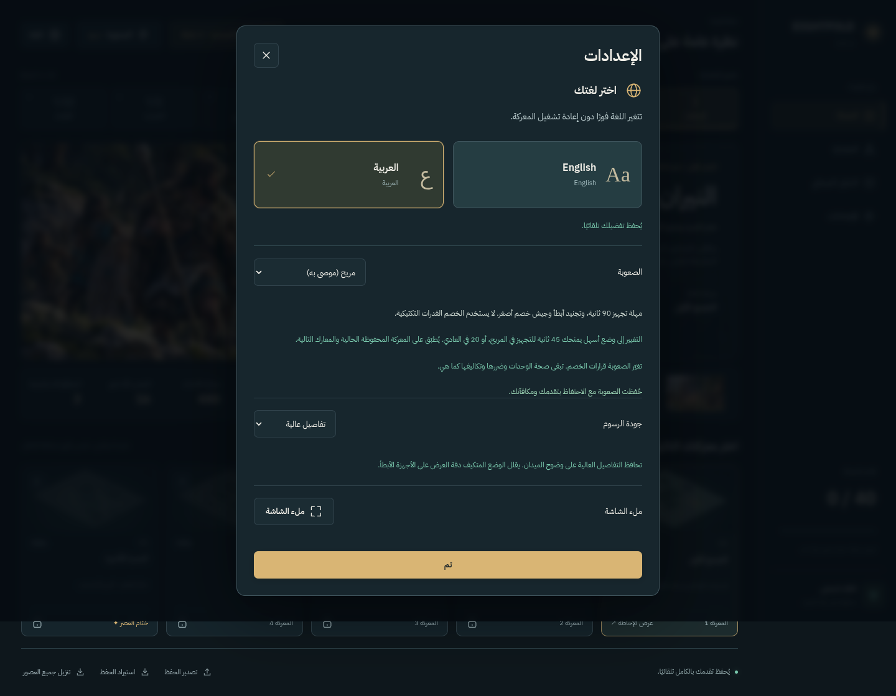
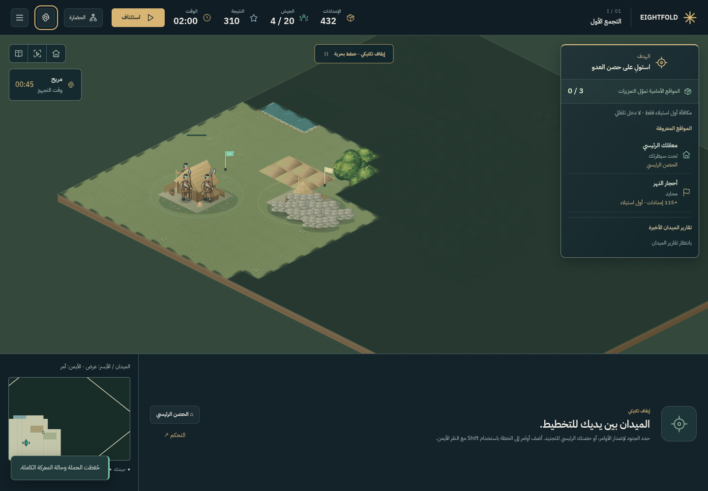

# الصعوبة وفرصة التقدّم — 19 أكتوبر 2026

كان الخصم الأصلي يقرر كل ثانية ويجنّد بسرعة ويستخدم القدرات والمناورات تلقائيًا. أضفنا ثلاث درجات لتوفير وقت للتعلّم والتجهيز، مع إبقاء الخصم الأصلي باسم **مخضرم**.

## كيف تخفف صعوبة جولتك الحالية؟

اختر **الإعدادات ← الصعوبة ← مريح (موصى به)**. يمكنك فتح الإعدادات من الحملة قبل الاستئناف أو أثناء المعركة، وكذلك الضغط على مؤشر الصعوبة في الميدان. يطبق التغيير على المعركة المحفوظة الحالية والمعارك التالية، ويُحفظ تلقائيًا.

| المستوى | تجهيز بداية معركة جديدة | تجهيز عند التحويل إليه من مستوى أصعب | سلوك الخصم |
|---|---|---|---|
| مريح — Relaxed | 90 ثانية | 45 ثانية | قرارات كل 3 ثوانٍ؛ تجنيد واحد كحد أقصى كل 12 ثانية؛ هدف جيش أصغر؛ دون التفاف أو استطلاع أو بناء أو قدرات مفعّلة |
| عادي — Standard | 30 ثانية | 20 ثانية | قرارات كل ثانيتين؛ تجنيد واحد كحد أقصى كل 4 ثوانٍ؛ هدف جيش متوسط؛ تكتيكات أكثر مع تقييد تفعيل قدرات الوحدات |
| مخضرم — Veteran | دون مهلة | دون مهلة | الخصم الأصلي بقرارات كل ثانية وكامل التكتيكات |

الأوقات هي ثواني المحاكاة: يتوقف العدّاد عند الإيقاف التكتيكي بزر **Space**، وتبقى المهلة المتبقية محفوظة بعد الإغلاق والاستئناف. لا تعيد إعادة التحميل أو اختيار المستوى نفسه بدء المهلة. الانتقال إلى مستوى أصعب ينهي مهلة التجهيز الحالية.

خلال التجهيز يبقى الخصم قرب قلعته أو يعود إليها، لكنه يدافع طبيعيًا إذا هاجمته. هدف التجنيد هو 55% من السعة في المريح و80% في العادي، مع احتساب الجنود والطوابير والاحتياط، واحترام الجيش الابتدائي الموجود والسقف المعتاد. لا يُحذف جيش قائم عند تخفيف الصعوبة.





## الحفظ والعدالة

الحملات الجديدة تبدأ على **مريح**. تحتفظ ملفات الحفظ القديمة بالذكاء الأصلي **مخضرم** إلى أن تختار تخفيفه بنفسك، حتى لا يتغير سلوك معركة محفوظة دون اختيارك.

يحافظ التغيير على جيشك وصحته وموارده وأوامره وطوابير الإنتاج والمهارات وتقدم الحملة والمكافآت. تُستبدل خطط هجوم الخصم عند التغيير، ويُمنح وقت التجهيز عند الانتقال إلى مستوى أسهل. لا تتغير صحة الوحدات أو ضررها أو درعها أو تكاليفها، ولا يحصل أي طرف على موارد إضافية. تبقى عتبات المكافآت مشتركة بين المستويات، ولا تُمنح العتبة المستحقة سابقًا مرتين.

## ما الذي قسناه؟

شُغّلت الجولات الخمس الأولى، كل واحدة مستقلة، بالأسلوب البسيط نفسه: تجنيد جنديين أماميين ثم رامٍ، وجمع الجيش نحو أقرب موقع معروف ثم قلعة الخصم، بقرار كل خمس ثوانٍ. استُخدمت نقاط المهارات الثلاث الابتدائية فقط، دون قدرات أو تشكيلات أو تحكم قتالي متقدم.

| المستوى | انتصارات هذا الأسلوب | هزائم | جولات علقت أو تجاوزت المهلة |
|---|---|---|---|
| مريح | 5 من 5 | 0 | 0 |
| عادي | 5 من 5 | 0 | 0 |
| مخضرم | 2 من 5 | 3 | 0 |

نجحت الجولة الأولى على المريح أيضًا **دون شراء أي مهارة**، في 47.8 ثانية محاكاة. تطابقت حسابات الدخل والإنفاق ومكافآت القتل والاستيلاء لدى الطرفين في الاختبارات الستة عشر.

هذه نتائج أسلوب آلي محدد، وليست تقديرًا لنسبة فوز اللاعبين. المقارنة المباشرة تخص العصر الأول؛ تحتاج العصور اللاحقة وتجارب اللاعبين إلى متابعة لضبط التوازن. يظل الفوز معتمدًا على التجنيد والتخطيط والاستيلاء، حتى في الوضع المريح.

نجحت **103 اختبارات Node**، و**8 سيناريوهات للصعوبة** في متصفح Chromium، إضافة إلى إعادة **8 اختبارات للعربية** و**11 للإنتاج واللعب دون اتصال**، دون أخطاء JavaScript في تلك السيناريوهات. شملت اختبارات الصعوبة تعديل معركة متوقفة والحفظ والاستئناف واستيراد الملفات القديمة وثبات المكافآت. يمكن مراجعة [النتائج المحفوظة](DIFFICULTY_RESULTS.json).

## إعادة الاختبار

بعد تثبيت التبعيات:

```sh
npm test
npm run build
npm run test:balance
npm run test:balance -- --no-skills --mode=relaxed --mission=e1m1
```

مع تشغيل خادم التطوير في طرفية أخرى، يشغّل `npm run test:difficulty` اختبارات متصفح معزولة؛ لا يقرأ حفظ اللاعب الحقيقي. تُكتب التقارير والصور تحت `test-results/difficulty/` ومقارنات التوازن تحت `test-results/difficulty-balance/`.
