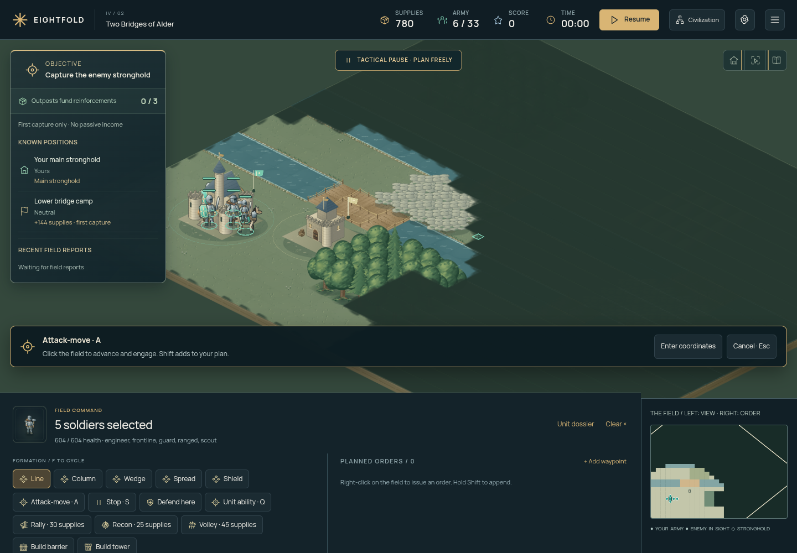
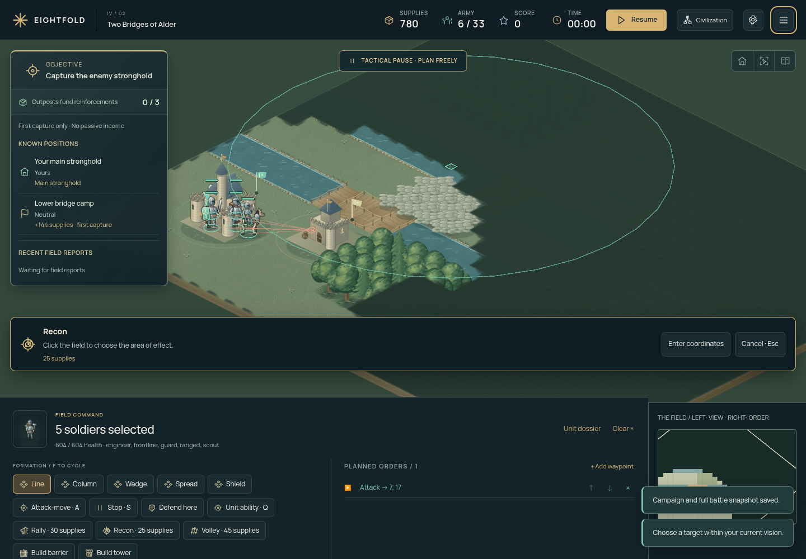
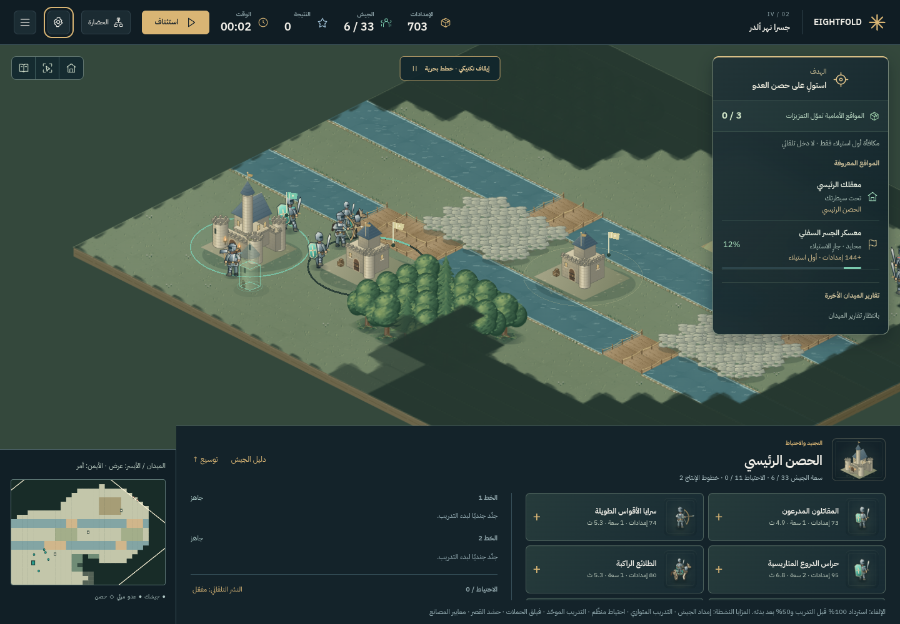
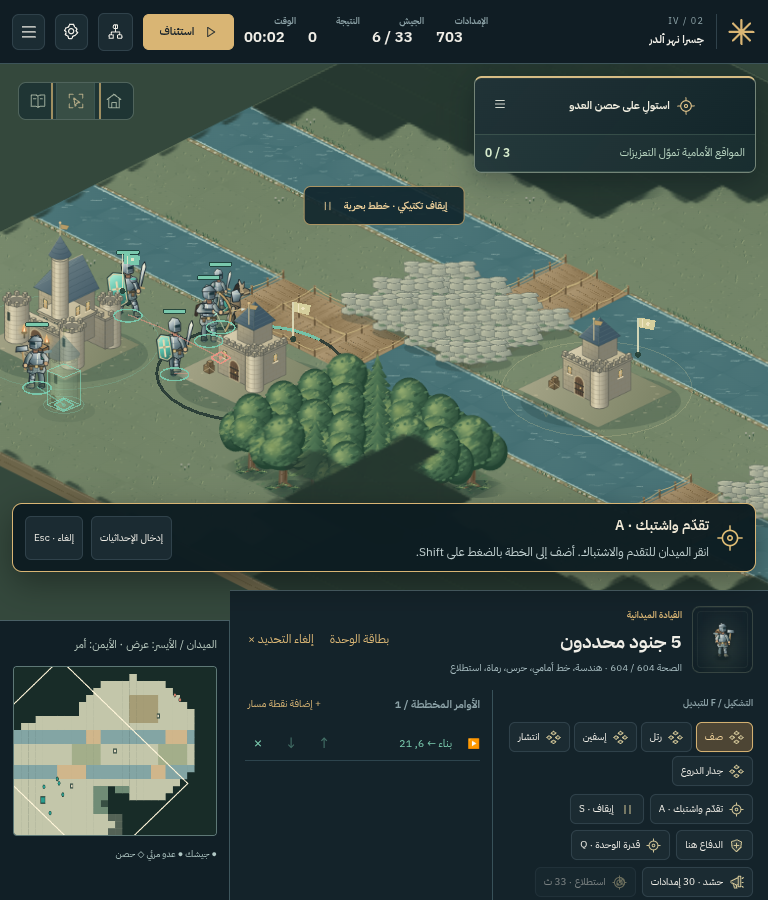
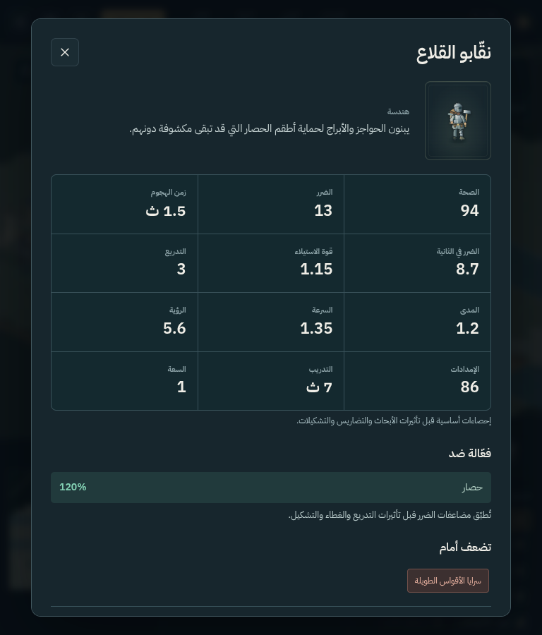

# مراجعة اللعبة وتطويرها — 18 أكتوبر 2026

راجعنا اللعبة بصريًا وفي المتصفح، ثم فحصنا المحاكاة والحفظ والتوازن. كانت أبرز
الفجوات في وضوح القرارات واستجابة الأوامر والتعافي من الأعطال، إلى جانب ضباب الحرب.
يوثّق [التقرير التقني الكامل](PROFESSIONAL_REVIEW.md) الأدلة والاختبارات وحدود النتائج.

## ماذا كان ينقصها؟

| الجانب | المشكلة المؤكدة | ما نُفّذ |
|---|---|---|
| التحكم | الجندي يواصل الاشتباك ويتجاهل الانسحاب عند وجود عدو قريب | الحركة العادية تنسحب؛ أمر «تقدّم واشتبك» مستقل عبر A ثم النقر |
| الاستهداف | استخدام القدرات والبناء عبر إحداثيات رقمية | استهداف مباشر ومعاينة النطاق أو المنشأة، مع إبقاء النموذج الرقمي للوحة المفاتيح |
| وضوح المعركة | غياب متابعة دائمة للأهداف والتقدم والخطر | لوحة مواقع معروفة، ونسب استيلاء، ومكافآت، وتقارير، وتنبيهات قرب الحصن |
| التخصص العسكري | صعوبة مقارنة الأدوار وفهم الوحدات المضادة | بطاقة وحدة ودليل جيش: إحصاءات أساسية، سرعة الهجوم، نقاط القوة والضعف، قدرات الدور والتضاريس |
| التعلّم | القتال يبدأ أثناء قراءة الدليل الأول | بدء الدليل متوقفًا قبل أول خطوة محاكاة، مع تصحيح الضغط السريع على الإيقاف |
| الرسوم | ضباب ذو حواف مربعة وتكرار رسم مئات المضلعات | صورة ضباب مخزنة تتحدث عند تغير الرؤية، وحواف أنعم دون كشف معلومات مخفية |
| التخطيط | تكرار القدرات أثناء الإيقاف يراكم أوامر أو يستخدم الهدف القديم | آخر هدف مخطط لكل قدرة؛ تفعيل واحد لقدرة الوحدة وطابور محدود |
| الحفظ | إعادة توزيع المهارات بعد معركة منتهية تنتج حفظًا غير صالح | إزالة لقطة المعركة المنتهية فقط مع الاحتفاظ بسجلات الحملة والمكافآت |
| الثبات | تعطل المحاكاة يترك ميدانًا متجمدًا، واحتمال تداخل الجلسات | مهلة بدء، وطلبات حفظ مترابطة، وحماية من الرسائل القديمة، واستعادة آخر لقطة متوقفة |
| حماية التقدم | بدء محاولة جديدة يستبدل المعركة غير المكتملة مباشرة | اختيار واضح بين الاستئناف والاستبدال والاحتفاظ بالحفظ |
| العربية | أسماء أدوار بقيت بالإنجليزية داخل بطاقات جديدة | ترجمة صريحة واختبارات للنص الظاهر، مع تخطيط RTL للاستهداف |
| التحقق المستمر | غياب فحص آلي عند الرفع | GitHub Actions للاختبارات والبناء عند كل push وطلب دمج |

## رحلة اللاعب بعد التعديل

1. **الحملة — جيدة:** التقدم واضح، والمعركة غير المكتملة محمية بخيار الاستبدال.
2. **شجرة المهارات — تعمل؛ التوازن يحتاج تجارب بشرية:** الشراء والمتطلبات وإعادة التوزيع محفوظة. لم نغيّر أرقام المكافآت بلا بيانات كافية.
3. **بداية اللعب — محسّنة:** وقت قراءة الدليل لا يُحتسب من المعركة، والإيقاف السريع يحافظ على آخر طلب.
4. **المعركة — محسّنة:** الأهداف والاستهداف والبناء والانسحاب ومعلومات التخصص متاحة داخل سياق اللعب.
5. **التجنيد والعربية — محسّنان:** دليل كامل لأدوار العصر، وبطاقات مترجمة، وتحكم يحافظ على حدوده عند عرض 768 بكسل.

## صور قبل التطوير وبعده

[قبل: لوحة الأوامر](screenshots/pro-audit/before-command.png) ·
[قبل: الدليل أثناء القتال](screenshots/pro-audit/before-tutorial.png)

## النتائج وحدودها

نجح البناء و85 اختبارًا آليًا، إضافة إلى سيناريوهات المتصفح للتكتيك والحفظ والتعافي
والترجمة والعمل دون اتصال. أُعيدت محاكاة المهمات الأربعين بعد تعديل الحركة، وانتهت
جميعها طبيعيًا. راجع [سجل التحقق](VERIFICATION.md) للأرقام وطريقة إعادة الاختبارات.

ما زال الحكم على صعوبة الحملة وتوزيع مكافآت الإتقان يحتاج لعبًا بشريًا. تتيح الأبحاث
حاليًا مجموعة العقائد نفسها للطرفين عند بدء المعركة؛ ينبغي تقييم هذا الاختيار في
اختبارات التوازن. كذلك لم يُقَس الأداء على بطاقة رسوم فعلية؛ بيئة الاختبار تستخدم
WebGL برمجيًا. لا تثبت هذه النتائج بلوغ رسوم AAA أو معدل إطارات محدد أو دعم تحكم
لمسي كامل أو مطابقة شاملة لمعايير الإتاحة.
